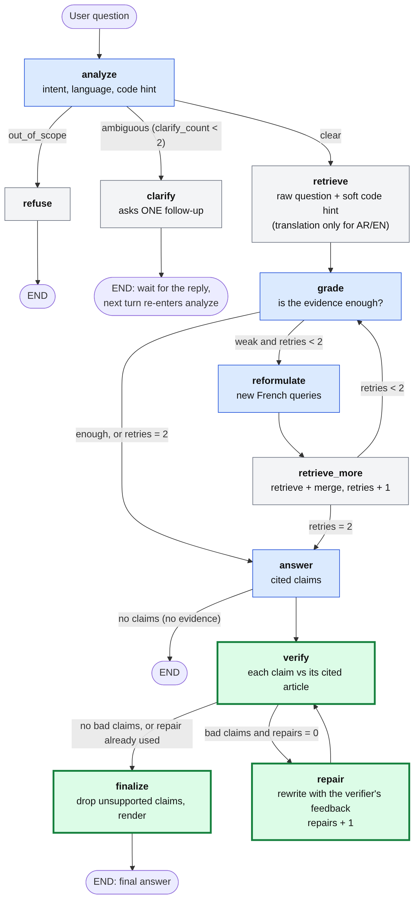
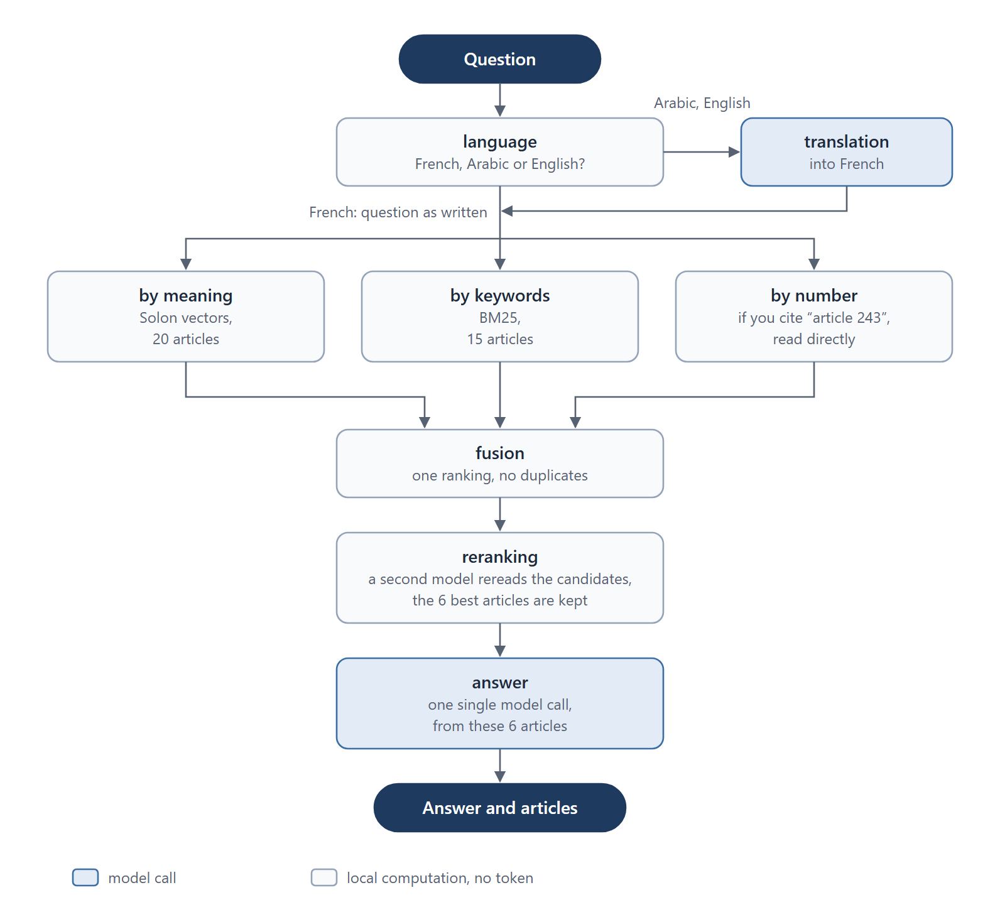

# Tunisian Legal RAG

Question answering over Tunisian legal codes (penal, civil procedure, labour, obligations and contracts, personal status,
commerce and others, 14 PDFs in `data/`). Ask in French, Arabic or English; the answer is written in your language and
every claim cites the article it comes from. If the question is vague the assistant asks for details, and if it is outside
the corpus it declines.

## How it works

The main system is an agent built with LangGraph (`agent/agent_graph.py`):

```
question -> condense -> analyze --+--> clarify (vague question, asks the user)
                                  +--> refuse  (out of scope)
                                  '--> retrieve -> answer --+-- they answer -------> verify -> finalize
                                          ^   (judges the   |                          '-> repair (re-checked)
                                          |    articles)    +-- they do not (once) -> reformulate --.
                                          '-----------------------------------------------------------'
                                                            +-- unclear -> clarify
                                                            '-- nothing found -> says so
```



The one-pass mode: 

- **condense**: rewrites a follow-up question so it stands alone.
- **analyze**: detects language, intent (answer, clarify, refuse) and which legal codes are concerned.
- **retrieve**: the query is normalized into French legal wording once (`agent/normalize.py`), then hybrid search runs
  (below).
- **answer**: reads the articles and judges whether they answer (`config.ANSWER_FIRST`). If they do, writes short claims, each
  citing article ids from the evidence. If not, **reformulate** writes new queries and the search runs once more; if the
  question turns out to be unclear, the user is asked; if nothing answers, the agent says so. With `ANSWER_FIRST = False`
  a separate **grade** step decides before the answer, as in the evaluated versions.
- **verify / repair**: each claim is checked against the article it cites; unsupported claims are repaired or dropped.

Retrieval (`retriever.py`, `reranker.py`):

1. Semantic search (Solon embeddings in ChromaDB) and BM25, per query and per detected code.
2. Direct lookup when the question names an article ("article 243").
3. Pools merged, then reranked with a multilingual cross-encoder; the best articles go to the model: 8 in
   the agent (`AGENT_TOP_K`), 6 in the one-pass pipeline (`RERANK_TOP_K`).
4. Articles cross-referenced by the evidence are added.

Indexing: each PDF is cut into one chunk per article (`splitter.py`). The chunk text starts with the code and heading path,
and very long articles are split into sub-chunks. The index is `db_v1_2/`. `config.py` has every switch;
`INDEX_V12 = False` goes back to `db_v1_1/`.

There is also a simpler one-pass pipeline (`pipeline.ask_question`: rewrite, retrieve, rerank, answer) used as the
baseline in evaluation.

| Part | Choice |
|---|---|
| Embeddings | `OrdalieTech/Solon-embeddings-large-0.1` |
| Reranker | `cross-encoder/mmarco-mMiniLMv2-L12-H384-v1` |
| Vector store | ChromaDB (local files) + BM25 |
| LLM | `openai/gpt-oss-120b` through Groq (`LLM_MODEL` in `config.py`) |
| PDF parsing | PyMuPDF |
| Interfaces | Gradio (`app.py`), Streamlit (`ui/app.py`), FastAPI (`api/`) |

## Setup

```bash
conda create -n rag-app python=3.11
conda activate rag-app
pip install -r requirements.txt gradio==6.17.3 torch   # requirements.lock.txt is the full lock of the dev machine
```

Put your Groq key in a `.env` file at the root (never commit it):

```
GROQ_API_KEY=...
```

The PDFs are in `data/`. To rebuild the index (about 10 minutes, needs the embedding model downloaded once):

```bash
python -c "import pipeline; pipeline.build_vectorstore()"
```

## Run

```bash
python app.py                      # Gradio web chat on http://127.0.0.1:7860 (RAG_UI_DEMO=1: canned answers, no models)
ui
un.cmd                         # the older Streamlit chat (Windows)
uvicorn api.api:app --port 8000    # HTTP API
```

```bash
curl -X POST localhost:8000/ask -H "Content-Type: application/json" -d "{\"question\": \"Quelle est la peine pour le vol ?\"}"
```

For the FastAPI service, set `API_KEY` to require an `X-API-Key` header on `/ask`; without it the endpoint is open, so don't
expose it that way. On the Space, use `/answer` (below).
Questions are limited to 1000 characters. The API response has `answer` and `sources` (id, source, article). Set
`HF_HUB_OFFLINE=1` once the models are cached.

The Gradio page has a sidebar with the visitor's past conversations (kept in their browser), a choice between two modes
(**Agent**: the full graph above, with verification; **Rapide**: the one-pass pipeline on the question as written, no memory
and no verification, far fewer tokens), a token meter (input and output tokens of every question, summed over all model calls), and a "Comment ça
marche" tab with the agent diagram.

Every question and answer the web interface handles is written to a SQLite file, `logs/interactions.db` (`RAG_LOG_DB`
changes the path): time, session id, question, status, answer, claims, cited article ids, whether verification failed,
mode, input and output tokens (and how many were cached or reasoning), seconds, and whether the owner's or the visitor's key was used. API keys are never stored.
The interface tells visitors that questions are recorded.

## Deploy on a Hugging Face Space (Gradio)

The YAML block at the top of this file configures the Space (`sdk: gradio`, entry point `app.py`).

1. Create a Space with SDK **Gradio** (blank template). Free accounts may be limited to ZeroGPU hardware; the app runs on CPU
   and only defines one unused `@spaces.GPU` function, because ZeroGPU Spaces refuse to start without one.
2. Add your SSH public key at https://huggingface.co/settings/keys, then push this repository (the index `db_v1_2/` is in
   git LFS, which Spaces require for files over 10 MB: run `git lfs install` once):

       git remote add space git@hf.co:spaces/<user>/<name>
       git push space <branch>:main

3. In the Space settings, under **Secrets** (never under Variables, which anyone can read once the Space is public):
   - `GROQ_API_KEY`: the shared key every visitor uses until its limits are reached; after that, the page asks visitors
     for their own (free) Groq key and opens the box for it.
   - `API_KEY`: a long random password for the `/answer` API (below). Without it the API refuses every call.

   And under **Variables** (all optional):
   - `UI_OWNER_DAILY_CAP`: questions per day on the shared key, for everyone together (30 by default, `0` = no limit).
   - `UI_VISITOR_HOURLY_CAP`: questions per hour for one visitor on the shared key (10 by default, `0` = no limit). A
     visitor's own key is never limited.
   - `UI_OWNER_KEY`: `off` makes every visitor use their own key; leave it unset otherwise.
   - `UI_ANSWER_CACHE`: `off` recomputes every answer (for testing). By default the first question of a conversation
     reuses the answer already given to the same question, kept in memory until the next restart.
   - `UI_TOKENS_PER_DAY`: the daily token limit of the shared key (200000 by default), for the "tokens left" meter. It is
     an estimate: the limit minus what was used through this app in the last 24 hours.
   - `API_DAILY_CAP`: questions per day through the API (no limit by default).
   - Keeping the log (a Space loses its disk at each restart), one of:
     - `RAG_LOG_BACKUP_DIR`: a folder of a private Storage Bucket mounted read-write in the Space, for example
       `/data/logs` (no token needed). The database is copied there after every question, as one file per start. Do not
       point `RAG_LOG_DB` at the bucket: the mount takes whole-file writes, not SQLite's in-place ones.
     - `HF_LOG_REPO` and `HF_TOKEN` (a secret): a private dataset repo (`user/rag-logs`) and a write token; copied at most
       every 5 minutes.

     `ui/store.py: load_all(folder)` merges the downloaded copies.
4. The Space installs `requirements.txt` and starts; the first question waits for the models to load (a minute or two).

Making the Space public: Settings, "Change Space visibility", Public. Before that, check that `GROQ_API_KEY` and `API_KEY`
are Secrets, that a log bucket or dataset is private, and that the Space branch carries no file you would not publish (the
branch pushed to the Space leaves out `eval/` exam files and `results/`). Commits show their author's name and e-mail.

### The `/answer` API (for programs, such as a voice assistant)

The page's own events are not part of the API; `/answer` is the only endpoint. Every call needs the header
`X-API-Key: <API_KEY>`. Parameters: `question` (1 to 1000 characters), `mode` (`agent` or `fast`), `conversation_id`
(send back the one you received to ask a follow-up question; empty for a new conversation), `groq_key` (optional, the
caller's own Groq key). It returns `status` (answer, clarify, refuse, not_found or error), `speech` (plain text to read
aloud: up to four sentences, then the law and its date), `answer` (the full answer, one line per sentence with its
articles), `sources`, `warnings` (a repealed article, an unverified answer), `language`, `conversation_id`, `tokens`.
Before that answer it sends one message per step, as the chat page shows them: `{"status": "working", "step": "retrieve",
"label": "Recherche des articles"}` (steps: condense, analyze, retrieve, grade, reformulate, retrieve_more, answer,
verify, repair...). `predict` ignores them and returns only the answer.

```python
from gradio_client import Client                     # pip install gradio_client
c = Client("<user>/<space>", headers={"X-API-Key": "<API_KEY>"})   # a private Space also needs hf_token="hf_..."
r = c.predict("Quelle est la peine pour le vol simple ?", "agent", "", "", api_name="/answer")
print(r["speech"])
r = c.predict("Et la tentative ?", "agent", r["conversation_id"], "", api_name="/answer")   # follow-up
job = c.submit("Quelle est la peine pour le vol simple ?", "fast", "", "", api_name="/answer")
for message in job:                                  # the steps as they happen, then the answer
    print(message.get("label") or message["speech"])
```

Without Python, two HTTP calls (the second streams the result):

```bash
curl -s -X POST https://<user>-<space>.hf.space/gradio_api/call/answer -H "X-API-Key: <API_KEY>" \
     -H "Content-Type: application/json" -d '{"data": ["Quelle est la peine pour le vol simple ?", "agent", "", ""]}'
# -> {"event_id": "..."}
curl -s -N https://<user>-<space>.hf.space/gradio_api/call/answer/<event_id> -H "X-API-Key: <API_KEY>"
```

The `Dockerfile` (Streamlit interface) is for self-hosting on a VM or a container service.

## Security notes

- Secrets live only in the `.env` file (git-ignored, excluded from the Docker image) or in the Space's Secrets. A scan of
  the working tree and all commits found no API key or token.
- The page escapes the HTML in user and model text, caps questions at 1000 characters, and never stores or logs an API
  key; a visitor's own key stays in their session only (the token meter knows it by a hash).
- Spending on the shared key is capped three ways: questions per visitor per hour, questions per day for everyone, and
  the provider's own daily limit. When it runs out, the page asks for the visitor's own key.
- The hourly limit identifies a visitor by the forwarded address chain; someone who forges it can get around that limit,
  but not around the daily cap.
- The `/answer` API refuses every call without the `X-API-Key` secret (compared in constant time) and is closed when
  `API_KEY` is not set. The page's own events are hidden from the API description, but a program can still drive the page
  like a browser does; the caps above apply to it.
- The log holds visitors' questions: keep the log bucket or dataset private. The page tells visitors that questions are
  recorded and not to enter personal data.
- Gradio is 6.17.3 (the `sdk_version` above): 5.23.1 had 16 published advisories (file copy through flagging, origin
  checks, SSRF, cookie injection, path traversal), fixed by 6.16. Check its advisories again before each release
  (`pip-audit`), and keep the page's events private (`api_visibility="private"`).

## Evaluation

The exam is `eval/answer_set.json` (100 questions: answer, clarify, refuse). It is split into two stages by
`eval/stages.json`, and `eval/exam_hashes.txt` fingerprints both so a run on a changed exam is refused.

```bash
python eval/preflight.py                                              # checks before a run
python eval/run_answer_eval.py --stage 1 --system v2 --dry-run        # plan, no call
python eval/run_answer_eval.py --stage 1 --system v2                  # run + judge
python eval/run_answer_eval.py --summarize                            # tables from saved runs
```

- Systems: `v2` (agent), `v1.1` (baseline pipeline), `v1` (original, run from its own git worktree at the
  `v1-baseline-runnable` tag).
- **Judge**: a second model grades each answer against reference points written by a lawyer and against the text of the
  cited articles. It reports whether the points are covered, whether the answer contradicts them, and which statements
  the cited articles do not support. It must differ from the generator: set `--judge-provider` (groq or gemini) and
  `--judge-model`, or `JUDGE_MODEL`. `eval/judge_check.py` tests a judge on canned cases before an exam run, and answers
  can be saved first and judged later with `--judge-only`.
- Article text for the judge comes straight from the PDF (`eval/pdf_truth.py`), not from the index. The same text is
  used to check that every number in an answer appears in the cited article.
- `eval/exam_hashes.txt` (and `noisy_set_hashes.txt`) store the SHA-256 of the exam files. A run is refused if the exam
  changed, so all results come from the same questions. After editing the exam, rerun `eval/make_stages.py`.
- `eval/noisy_set.json` holds the same questions with typos and informal wording (`eval/noisy_vs_clean.py` compares).
- Results are in `results/`; each file records the model, reranker, temperature and git commit/tags of the run.

Git tags mark the frozen states used as references: `v1-baseline` and `v1-baseline-runnable` (original pipeline, the
second with two config id fixes so it runs; the official v1 numbers), `v1.1-baseline` (retrieval fixes),
`agent-prompts-frozen` and `agent-retrieval-frozen` (agent prompts and retrieval at the time of evaluation) and
`v2-candidate`. Check out a tag in a separate worktree to reproduce it.

Unit tests (no model, no network):

```bash
python test_v21_retrieval.py
python agent/test_graph_logic.py
python agent/test_normalize_switch.py
python eval/test_run_harness.py
python ui/tests/test_ui.py
```

## Layout

```
config.py         models, paths, retrieval switches
loaders.py        PDF reading
preprocessing.py  header / watermark cleanup
splitter.py       one chunk per article
translate.py      query rewriting and translation (fast pipeline)
retriever.py      semantic + BM25 + direct lookup + fusion
reranker.py       cross-encoder
pipeline.py       index build and the one-pass pipeline
agent/            the LangGraph agent (nodes, prompts, tests)
api/              FastAPI service
app.py            Gradio web interface (Space entry point)
ui/               shared chat logic, page style, Streamlit interface, SQLite log
eval/             exam, harness, PDF ground truth, tests
results/          saved runs
data/             legal PDFs
db_v1_2/          current index (db_v1_1/ is the previous one)
Dockerfile        image for self-hosting (Streamlit)
```

## Chunk ids

Every article has a stable id: `<pdf stem>/s<NN>/<article label>`, for example `PenalFr/s02/243` or
`ProcedurepenaleFr/s01/13-bis`. `s<NN>` numbers the texts inside a PDF in reading order (several PDFs bundle a code with
decrees; a new section starts when article numbering restarts). Sub-chunks of a long article are `<id>#k` and keep the
article id as `parent_id`. A chunk starts only at a real heading (`Article N`, `Art. N`, `Article premier`); in-text
references do not split.

## License

MIT
